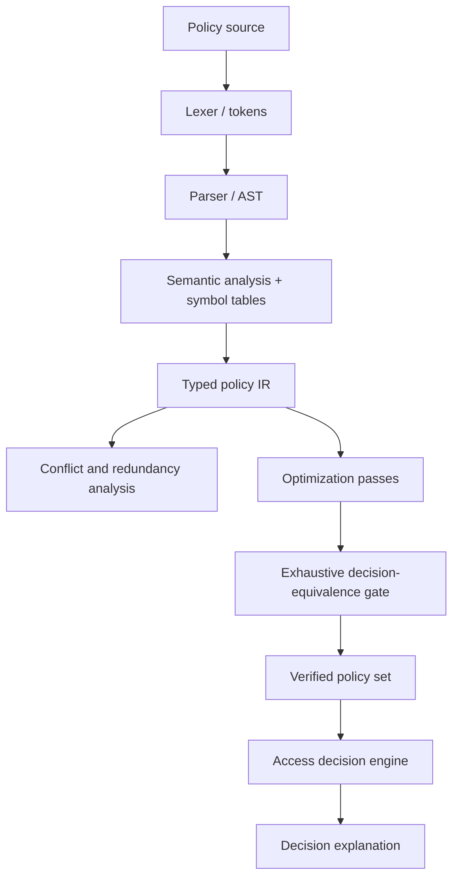
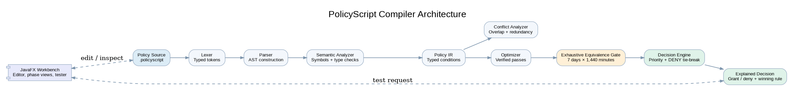
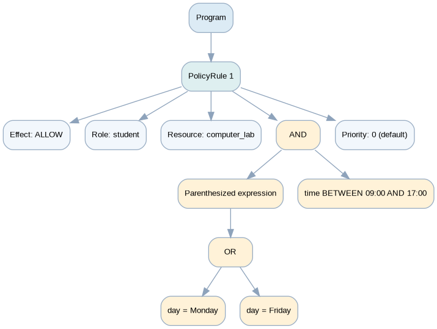

# PolicyScript — Access-Control Policy Compiler

**Compiler Design Project | Java 17 source target | Maven | JDK-matched JavaFX | JUnit 5**

PolicyScript is a small domain-specific language (DSL) and compiler workbench for writing, validating, analyzing, optimizing, and evaluating access-control rules. The implementation follows the terminology and demonstration workflow in the supplied class presentation: lexical analysis, syntax analysis and AST, semantic analysis, policy intermediate representation (IR), conflict/redundancy analysis, optimization, and explainable access decisions.

> **Scope note:** this is a local policy-evaluation and compiler demonstration. It does not authenticate users, connect to a protected resource, or replace a production authorization service.

## Problem statement

As access-control rules grow, duplicate policies, contradictory decisions, invalid conditions, overlapping time windows, and rules that do not affect a final decision become difficult to identify manually. PolicyScript turns readable rules into typed representations so those issues can be reported before requests are evaluated.

## Objectives

- Implement a real lexer and recursive-descent parser for a documented policy DSL.
- Build an AST and validate role/resource names, day/time values, comparators, and priorities against configuration.
- Normalize valid source into a typed policy IR.
- Detect duplicate rules, direct conflicts, conditional overlap, impossible predicates, and decision-redundant rules.
- Apply conservative optimization and prove that both ALLOW/DENY decisions and the winning policy/priority explanation are preserved.
- Evaluate an interactive access request with deterministic resolution and a plain-language explanation.
- Keep the compiler core independent of JavaFX so the logic can be tested without opening the UI.

## Implemented features

- `ALLOW` and `DENY`, configurable exact-match role/resource names, optional `PRIORITY`, weekday and time conditions.
- Boolean `AND`, `OR`, parentheses, inclusive `time BETWEEN HH:mm AND HH:mm`, and type-aware time/day comparisons.
- Line/column/source-offset-aware tokens and actionable lexer/parser/semantic diagnostics.
- AST tree and Graphviz DOT export; optional PNG render when the Graphviz `dot` executable is installed.
- Structured IR with stable source rule IDs, source order, source text, source location, normalized condition objects, and numeric priority.
- Exact finite-domain condition overlap checks across **7 weekdays × 1,440 minute values**.
- Duplicate elimination, safe Boolean-condition simplification, and decision-redundant/unreachable rule removal.
- A pass-by-pass equivalence gate; failed candidate transformations are reverted. The final gate checks the winning policy identity, effect, numeric priority, source order and ALLOW/DENY decision at every supported weekday/minute point.
- JavaFX desktop application with one Policy Editor, compiler pipeline, AST/tokens/symbol-table views, issue filters, before/after IR, optimizer audit, configuration loading, and one academic-only Access Control screen for registered students.
- One additional **Campus Management** tab for class creation/editing/deletion, single and bulk student enrolment/removal, many-to-many class memberships, editable custom groups with multi-select add/remove membership, teacher create/edit/delete, teaching assignments, weekly building/room timetable slots and campus ALLOW/DENY policy forms.
- Academic timetable and policy records are lowered to deterministic PolicyScript role/resource identifiers and inserted into a marked managed block in the one original Policy Editor. Hand-written source outside the block is preserved, and the combined source is compiled by the existing compiler and evaluated by the same decision engine. The original compiler grammar is retained.
- Exactly one top-level **Academic Access Control** screen evaluates registered students against academic policies only. The academic interface does not provide generic `student` / `teacher` role access modes or teacher authorization policies. Teacher records and teaching assignments remain available for academic administration and timetable validation, not for access requests.
- Local versioned academic data persistence in `%USERPROFILE%/.policyscript/academic-data.psdb` (with one-time migration from the previous project-relative `data/academic-data.psdb` path and an in-app import action for older project copies), with validation for duplicate enrolments, timetable overlaps by class/room/teacher/student, and protection against corrupt-file overwrite. The **Reload saved policies + open Policy Editor** action now reloads the committed file into a validated temporary repository, replaces the live records only after successful validation, refreshes the management tables, regenerates the marked source block, and opens the existing Policy Editor. If the file is invalid, the operation reports the exact file/error and keeps the prior in-memory snapshot and editor unchanged. Timetable entries describe location/time only and do not grant access automatically.
- A one-click large fictional demonstration workspace generator: **8 classes, 200 students, 5 custom groups, 16 teachers, 16 teaching assignments, 16 timetable slots and 5 academic policies**. Loading the dataset requires confirmation; replacing a non-empty workspace creates a timestamped backup first. All generated IDs and records are fictional and editable.
- CLI entry point for running the same compiler core without the desktop UI.
- Bundled valid and invalid policy samples plus a dependency-free core verification runner.

## Academic scheduling and access-policy extension

The additional **Campus Management** tab adds class creation/editing/deletion, single or bulk student enrolment and removal, many-to-many class membership, custom student groups with multi-select member addition/removal, teacher create/edit/delete, teaching assignments, timetable slots, and ALLOW/DENY policies scoped only to (1) an academic class, (2) a custom student group, or (3) one exact registered student. Bulk enrolment accepts one student per line as `REGISTER_NUMBER, Full Name` or `REGISTER_NUMBER<TAB>Full Name`; the entire batch is validated before any record is saved.

Custom groups can be created empty or with multiple selected existing students. Their membership can be updated with explicit add/remove operations that preserve other members. Students can belong to multiple classes and groups. Teachers can be edited/deleted after referenced assignments are removed. **Campus Management is a policy-authoring form, not a second policy editor**: every academic policy change automatically regenerates a managed source block in the one original **Policy Editor**, preserving user-authored source outside that block. The single **Academic Access Control** screen evaluates students only after the combined source compiles successfully. Teacher assignments are scheduling metadata; there are no generic teacher/student role access policies in the academic UI. Data is saved locally in `%USERPROFILE%/.policyscript/academic-data.psdb`. The Campus Management header shows the active data path and record counts. If an older project folder contains the previously saved `data/academic-data.psdb`, use **Import previous campus data (.psdb)** in Campus Management; the selected file is validated before import and the current workspace is backed up before replacement.

The **Reload saved policies + open Policy Editor** button re-reads the active `.psdb` from disk before source generation; it does not rely only on the current in-memory collections. It remains enabled when the saved policy list is empty so stale generated blocks can be removed. After a successful refresh it opens the one original Policy Editor. The **Load large fictional demo (200 students)** button seeds a deterministic 8-class demo campus; if data already exists, the app asks for confirmation and creates a backup before replacement.

The application maximizes to the current display's visual bounds and uses scrollable sub-sections and wrapping action rows so the forms remain reachable on smaller screens. For the current strict all-matching-priorities-unique rule, see [V18 priority rules](docs/PRIORITY_RULES_V18.md) and [V18 verification](docs/VERIFICATION_V18.txt). For JDK selection, see [the V16 JDK build compatibility note](docs/JDK_BUILD_COMPATIBILITY_V16.md), [the V15 final source and workspace audit](docs/FINAL_AUDIT_V15.md), [the V15 verification record](docs/VERIFICATION_V15.txt), [the V13 cross-scope priority matrix and optimizer audit](docs/ACADEMIC_PRIORITY_MATRIX_V13.md), [the V11 saved-policy refresh and demo-data notes](docs/FINAL_V11_REFRESH_AND_DEMO.md), [the V12 build-stability notes](docs/BUILD_STABILITY_V12.md), [the campus extension guide](docs/ACADEMIC_SCHEDULING_AND_POLICY_EXTENSION.md), [V9 acceptance notes](docs/FINAL_V9_ACCEPTANCE.md) and [V9 policy-editor synchronization notes](docs/FINAL_V9_POLICY_EDITOR_SYNC.md) for the workflows, safeguards, verification and remaining limitations.

## Compiler pipeline





Example AST visualization generated from a parsed PolicyScript rule:



Each stage consumes the previous stage's actual result. A lexical, syntax, or semantic error blocks IR generation and access evaluation. A repeated-priority conflict is a blocking policy-analysis ERROR: the source can still be tokenized, parsed and represented in IR so the conflict can be explained, but an access request affected by that tie receives `PRIORITY CONFLICT ERROR` and no ALLOW/DENY decision.

## Technology stack

- JDK 17, 21, 22, or 23+ (Maven automatically selects the matching JavaFX/RichTextFX profile)
- Maven 3.8+ (Maven must run under the JDK profile you intend to use; check `mvn -version`)
- JavaFX Controls for the desktop UI
- RichTextFX for a code editor with line numbers and syntax highlighting
- JUnit Jupiter 5 for automated tests
- JSON arrays for configurable roles and resources
- Graphviz DOT export with optional `dot` PNG rendering

## Requirements

Install:

1. JDK 17 or newer (`java -version` and `javac -version`).
2. Maven 3.8+ (`mvn -version`).
3. For AST PNG rendering only, Graphviz and the `dot` executable on `PATH`.

Maven downloads JavaFX, RichTextFX, JUnit and build plugins during the first build, so network access may be required the first time. For JDK 25, `mvn -version` must show JDK 25 so Maven activates JavaFX 25.0.5 and RichTextFX 0.11.7.

## Build, run and test

Run these commands from the project root (`policyscript-project/`).

### Build

Maven's generated output is placed outside the project directory at `%USERPROFILE%/.policyscript/build/policyscript-compiler` on Windows (or the equivalent `${user.home}` path). This avoids OneDrive/IDE locks on a project-local `target` directory. Surefire runs tests in Maven's own JVM to avoid the forked test-classpath problem observed on the supplied Windows/JDK 25 environment. V16 profiles select JavaFX 21.0.6 + RichTextFX 0.11.2 for JDK 17/21, JavaFX 24.0.1 + RichTextFX 0.11.2 for JDK 22, and JavaFX 25.0.5 + RichTextFX 0.11.7 for JDK 23+.

```bash
mvn -U clean verify
```

On Windows, you can run `verify-build.bat` from the project root. For tests only, use `mvn -U clean test` or `run-tests.bat`.

### Launch the JavaFX desktop application

```bash
mvn javafx:run
```

The bundled source and configuration are loaded when the application starts. Choose **Compile & analyze** in the Policy Editor to run the compiler. All dashboard metrics and stage outputs are updated from that compilation.

### Run the CLI against the demonstration policy

```bash
mvn exec:java -Dexec.mainClass=com.policyscript.cli.PolicyScriptCli -Dexec.args="src/main/resources/sample-policies/demo.policyscript --request student computer_lab Monday 14:00"
```

Evaluate a simple valid policy instead:

```bash
mvn exec:java -Dexec.mainClass=com.policyscript.cli.PolicyScriptCli -Dexec.args="src/main/resources/sample-policies/valid.policyscript --request student computer_lab Monday 14:00"
```

### Run JUnit tests

```bash
mvn clean test
```

The JUnit suite is in `src/test/java/com/policyscript/PolicyScriptCompilerTest.java` and covers lexer, parser, semantic validation, analysis, optimization, runtime resolution, and end-to-end compilation.

### Run the dependency-free core verification (does not need Maven or JavaFX)

```bash
bash tools/run-core-verification.sh
```

This script compiles the compiler and academic domain modules with `javac --release 17` and runs 92 compiler assertions, 92 academic-management/policy assertions, 31 cross-scope priority-matrix checks, 16 priority-conflict diagnostic checks, 5 selector checks, 29 UI-integration checks, 9 workspace-management checks and 11 deletion-integrity checks (285 total). It also parses all 49 production, JUnit-test and tool Java source files for syntax errors. The checks include single and bulk enrolment in new/existing classes, multi-class student memberships, selected membership removal, comma/tab input parsing with row-level errors, all-or-nothing duplicate validation, empty and editable groups, selected group add/remove operations, teacher create/edit/delete, automatic managed-source refresh, class/group/student policy scoping, no implicit timetable ALLOW, inactive saved-policy visibility and reload regeneration in the editor, inactive-to-active policy transitions, explicit navigation to the single Policy Editor, no-target fail-closed handling, screen sizing, persistence rollback, corrupt-file backup/recovery, and optimizer/runtime decision equivalence. It is useful for a machine that has a JDK but has not yet installed Maven. The core verification runner excludes JavaFX-dependent classes and is not a substitute for `mvn clean test` or a graphical launch.

## PolicyScript language reference

### Grammar (version 1)

```text
program             → rule+
rule                → effect IDENTIFIER TO ACCESS IDENTIFIER condition? priority? SEMICOLON
effect              → ALLOW | DENY
condition           → WHEN expression
expression          → orExpression
orExpression        → andExpression (OR andExpression)*
andExpression       → primaryCondition (AND primaryCondition)*
primaryCondition    → LPAREN expression RPAREN
                    | timeBetween
                    | comparison
timeBetween         → TIME_FIELD BETWEEN TIME_LITERAL AND TIME_LITERAL
comparison          → FIELD COMPARATOR VALUE
priority            → PRIORITY INTEGER
TIME COMPARATOR     → = | != | < | <= | > | >=
DAY COMPARATOR      → = | !=
```

`program → rule+` requires at least one rule. The order is `WHEN` condition first, optional `PRIORITY` second, then the semicolon. `AND` has higher precedence than `OR`; parentheses override precedence. The `AND` in `BETWEEN` separates the range endpoints and is not treated as the Boolean AND operator.
Parentheses are retained as explicit `Parenthesized expression` nodes in the AST rather than being discarded after parsing. The text AST viewer and Graphviz DOT export both display this node, and semantic validation/optimization traverse through it. The lexer also tracks source positions for LF, CRLF, and classic CR line endings.

### Keywords, names and literals

- Keywords and the field names `time` and `day` are case-insensitive.
- Configured role and resource names are matched **exactly** against the JSON configuration. `computer_lab` is a single identifier.
- Identifiers use `[A-Za-z_][A-Za-z0-9_]*`.
- A policy-source time token has the lexical shape `HH:mm`. Out-of-range values such as `25:00` are lexical time tokens but are rejected semantically; malformed shapes such as `9:0x` are lexical errors. The DSL and CLI use exact `HH:mm`; the JavaFX Academic Access Control screen also accepts convenient forms such as `9:00`, `900`, `930`, and `1400`, normalizes them to `HH:mm`, and rejects seconds or out-of-range values because v1's verified domain is minute-precision.
- Time comparisons support `=`, `!=`, `<`, `<=`, `>`, and `>=`. Day comparisons support only `=` and `!=` and values Monday through Sunday.
- Version 1 does not define comments, escaped identifiers, overnight ranges, roles inheritance, or other condition fields.
- Priorities are non-negative integers from `0` to `2,147,483,647`. **Smaller numbers mean greater importance**: `PRIORITY 1` beats `PRIORITY 10` when both rules match. An omitted `PRIORITY` clause defaults to `0`, so it has the same precedence as explicit `PRIORITY 0`.

### Example policies

```text
ALLOW student TO access computer_lab
WHEN time BETWEEN 09:00 AND 17:00
PRIORITY 10;

DENY student TO access computer_lab
WHEN time BETWEEN 12:00 AND 14:00
PRIORITY 1;

ALLOW faculty TO access computer_lab
WHEN day = Monday OR day = Friday
PRIORITY 5;

ALLOW faculty TO access server_room PRIORITY 10;
DENY guest TO access server_room PRIORITY 10;
```

Both endpoints of a time range are inclusive. A range such as `17:00 AND 09:00` is rejected; it is not silently interpreted as an overnight period. A range whose endpoints are equal represents one inclusive minute.

## Configuration

The bundled `src/main/resources/config/roles-resources.json` file is:

```json
{
  "roles": ["student", "faculty", "guest"],
  "resources": ["computer_lab", "server_room"]
}
```

The desktop application's **Configuration** tab can load a different JSON file using the same `roles` and `resources` arrays. Invalid configuration is reported and is not silently replaced with hard-coded defaults. Additional role/resource identifiers are loaded through configuration. The retired exact resource name `lab` is rejected in custom configuration as well; replace it with `computer_lab`.

### Canonical laboratory resource

The bundled configuration uses `computer_lab` as the single canonical laboratory resource, alongside `server_room`. The older identifier `lab` is deliberately not included in the bundled configuration. A policy source that still uses `TO access lab` fails semantic analysis with `SEM-UNKNOWN-RESOURCE`; update older policies to use `computer_lab`. The legacy compiler symbol table therefore retains one canonical laboratory resource; the academic Access Control screen uses room identities derived from the selected building and room.

The original master implementation prompt and presentation are preserved unchanged under `docs/`. They mention both `lab` and `computer_lab`; this bundled project applies the user's later instruction to treat them as one facility and standardizes the implementation on `computer_lab`.

## Decision-resolution semantics

Academic class, custom-group and individual-student policies are expanded to the exact registered student's generated identity, then compete in one shared resolver. **Policy scope does not automatically change precedence**: an individual policy is not automatically stronger than a group or class policy. Only matching rules for the same actor/resource/day/time are compared.

For a request `(role, resource, day, time)`:

1. Find every rule whose role and resource match exactly and whose condition is true. A rule without `WHEN` always matches.
2. If no rule matches, return **DENY by default**.
3. An omitted `PRIORITY` clause defaults to numeric priority `0`; it is equivalent to explicit `PRIORITY 0`.
4. The **smallest numeric priority wins**, but only after confirming that every matching policy has a distinct numeric priority. For example, priority `1` is stronger than priority `10`.
5. If **any two or more policies matching the same request reuse any numeric priority value**, return **`PRIORITY CONFLICT ERROR`**. This applies even when a third matching policy has a smaller numeric priority. For example, matching priorities `1, 10, 10` are an error; the unique `1` does not hide the repeated `10` values.
6. A decision is issued only when every matching policy has a unique numeric priority. In that case, the smallest number wins, regardless of whether its scope is class, group or individual student. Do not use effect, policy scope or source order to break a repeated-priority tie.
7. Equal priority values on policies that do **not** both match the same request are not a conflict. Different students, nonmember groups, different rooms, different days, or non-overlapping time windows are evaluated independently.

The same `DecisionEngine` resolver is used by access evaluation, policy analysis, optimization equivalence, the CLI and the GUI. Conflict Analysis reports every repeated-priority tier as severity `ERROR` with a concrete day/time witness and all participants. The Access Control screen reports the same error for the affected request and issues no ALLOW/DENY decision. Optimization equivalence preserves every matching rule and every repeated-priority participant in a conflict; it cannot hide a lower-tier repeated priority behind a smaller number or treat a conflict as ordinary default DENY.

## IR and optimization

Each IR rule records a stable ID (for example `R1`), effect, role, resource, typed condition, effective priority, source order, source location, and original source text.

Conflict analysis reports impossible conditions, exact duplicates, direct/conditional overlaps, repeated-priority conflict errors, fully shadowed rules, partially shadowed rules and decision-redundant rules. Priority conflicts are request-specific: the analyzer reports an error only where multiple policies with the same numeric priority actually match the same identity/resource/day/time request. Repeated values at any numeric tier are errors, including lower tiers beneath a smaller unique value. Equal values on rules that do not overlap in resource/day/time/identity are not conflicts. A three-way or larger duplicate tier is consolidated into one diagnostic for the full set of matching participants and repeated priority values. These classifications use exhaustive evaluation over the finite request domain.

Three passes run in sequence:

1. **Exact duplicate elimination candidate** — compares effect, scope, effective priority, and finite-domain condition truth sets. A duplicate that participates in any repeated-priority conflict is retained because deleting it would erase a real `PRIORITY CONFLICT ERROR`; an unreachable or genuinely non-winning duplicate can be removed only if the exhaustive trace proof permits it.
2. **Condition simplification** — simplifies supported Boolean expressions only when an exact finite-domain implication or equivalence proves it safe. For example, `time > 08:00 AND time > 10:00` simplifies to `time > 10:00`.
3. **Unreachable/redundant policy removal** — tries each removal and accepts it only when the same winning rule identity, priority, effect and source-order explanation remain selected for every request in the finite domain. A rule that is only outcome-redundant but currently wins is retained so its policy attribution is not lost.

After each pass, the candidate is compared with the input to that pass. If a pass fails equivalence, that pass is reverted. The final correctness gate enumerates every request across the role/resource combinations named in the two policy sets, all seven weekdays, and all 1,440 minutes. It reports a counterexample if the final decision, the unique winning policy identity/priority, or the complete matching-rule set or any repeated-priority conflict participant set changes. The UI uses optimized rules only after this stronger proof; Academic Access Control displays the full matching-policy trace from original compiled rules.

## Reproducible demo walkthrough

### 1. Successful compilation

Load `valid.policyscript` and click **Compile & analyze**. Inspect the token stream, AST and source-derived IR. The student request for `computer_lab` on Monday at `14:00` is granted because the time range includes that time.

### 2. Conflict detection and resolution

Load `demo.policyscript`. It contains an ALLOW range from `09:00` through `17:00` at priority `10` and a DENY range from `12:00` through `14:00` at priority `1`. Conflict Analysis should show an overlapping conditional conflict with a concrete witness. At Monday `14:00`, the DENY rule at priority `1` wins because the smaller number is more important. At Monday `11:00`, the ALLOW rule applies. At `18:00`, neither student computer_lab time rule matches and default DENY applies. The demo also includes unconditional `ALLOW faculty TO access server_room PRIORITY 10;`; faculty is granted server-room access at any weekday and minute, while guest is denied by the explicit DENY rule.

### 3. Priority ordering

In the Policy Editor, click **Load priority example** and compile. The sample first denies access at priority `10`, then allows access at priority `1`. At Monday `12:00`, the final decision is **ACCESS GRANTED** because the smaller numeric priority is more important. This example directly demonstrates numeric priority ordering without relying on the default priority value. If both matching rules are changed to the same priority, Conflict Analysis reports `PRIORITY CONFLICT ERROR` and the request receives no ALLOW/DENY result.

### 4. Optimization

Load `optimization.policyscript`. The two rules are semantically duplicates even though their Boolean operands are ordered differently. The optimizer removes one duplicate, simplifies the remaining condition to `time > 10:00`, and records the equivalence checks in the audit.

### 5. Invalid-input samples

Open `unknown-role.policyscript`, `unknown-resource.policyscript`, `invalid-time.policyscript`, or `malformed-syntax.policyscript`. The compile stops at the failing front-end phase; invalid input is not treated as a valid policy set.

### 6. Access tester

Select a configured role/resource and weekday, then enter a 24-hour time. The tester accepts `HH:mm` (such as `14:00`), `H:mm` (`9:00`), and compact `Hmm`/`HHmm` (`900`, `930`, `1400`), normalizing valid input back to `HH:mm`. Seconds and out-of-range times are rejected. The result includes the decision (or a `PRIORITY CONFLICT ERROR` with no decision), winning rule (if any), priority, matched rules, explanation and whether default DENY was applied. A priority conflict is never displayed as default DENY. Editing the source or changing configuration invalidates old compilation outputs and clears the previous decision so stale results are not presented as current.

## Sample files

| File | Purpose |
|---|---|
| `demo.policyscript` | Consistent `computer_lab` demonstration, time/day conflict, unconditional faculty access to `server_room`, and explicit guest denial |
| `valid.policyscript` | Valid compile scenario including faculty access to `server_room` and guest denial |
| `grouped-condition.policyscript` | Parenthesized OR expression combined with a time range; useful for AST inspection |
| `duplicates.policyscript` | Duplicate-rule analysis |
| `direct-conflict.policyscript` | Same-scope unconditional ALLOW/DENY conflict |
| `overlapping-time.policyscript` | Overlapping time conditions |
| `unknown-role.policyscript` | Undefined role diagnostic |
| `unknown-resource.policyscript` | Undefined resource diagnostic |
| `invalid-time.policyscript` | Invalid 24-hour time values |
| `malformed-syntax.policyscript` | Parser error for malformed BETWEEN syntax / missing terminator |
| `unreachable.policyscript` | Boolean predicate with an empty truth set |
| `optimization.policyscript` | Duplicate and safe condition simplification example |
| `priority-order.policyscript` | Shows priority `1` ALLOW defeating priority `10` DENY; load it with the Policy Editor's **Load priority example** button |

## Project structure

```text
policyscript-project/
├── pom.xml
├── README.md
├── run-app.bat
├── run-cli.bat
├── run-tests.bat
├── src/
│   ├── main/java/com/policyscript/
│   │   ├── analysis/       # exact predicate domains and policy findings
│   │   ├── ast/            # AST models and typed conditions
│   │   ├── cli/            # headless CLI entry point
│   │   ├── config/         # configuration loading and symbol sets
│   │   ├── diagnostics/    # central diagnostic model
│   │   ├── engine/         # shared resolver and request models
│   │   ├── ir/             # typed policy IR
│   │   ├── lexer/          # tokens and lexical analysis
│   │   ├── optimizer/      # verified optimization passes
│   │   ├── parser/         # recursive-descent parser
│   │   ├── semantic/       # semantic/type validation
│   │   ├── service/        # integrated compilation service
│   │   └── ui/             # JavaFX desktop workbench
│   ├── main/resources/
│   │   ├── config/
│   │   ├── sample-policies/
│   │   └── styles/
│   └── test/java/com/policyscript/ # JUnit 5 regression suite
└── tools/
    ├── CoreVerification.java
    └── run-core-verification.sh
```

## Known limitations

- This version supports only the documented day/time predicates and exact configured role/resource names.
- No real identity management, login, cloud deployment, external resource enforcement or database is included; those remain future scope.
- Overnight time ranges and user-defined language comments are not part of version 1.
- Graphviz PNG rendering is optional; DOT export and the text AST view work without Graphviz.
- Policy analysis may label a rule outcome-redundant when its removal preserves the final ALLOW/DENY bit, but if that rule currently wins, the optimizer retains it unless the exact winning-policy identity, effect, priority and source-order attribution are also preserved.
- Maven dependencies must be resolved on the target machine for the JavaFX/JUnit build. See `tools/run-core-verification.sh` for a JDK-only core check.

## Future enhancements

Role hierarchy and inheritance, additional condition fields, richer diagnostics, report export, database-backed configuration, and integration with an actual authorization gateway could be explored after version 1 is stable.

## Portfolio / resume summary

**PolicyScript — Domain-Specific Access-Control Compiler:** Built a Java compiler workbench with a position-aware lexer, recursive-descent parser, AST, semantic validation, typed intermediate representation, exact finite-domain policy conflict analysis, deterministic priority-based authorization evaluation, and pass-by-pass equivalence-verified optimization. Added a JavaFX desktop UI, configurable JSON role/resource symbol tables, CLI, sample policies, and JUnit 5 regression tests.

Only describe test counts or successful Maven runs based on results actually observed on the machine where the project is evaluated.


### Revised class presentation

The recommended presentation is `docs/PolicyScript_Final_Class_Presentation.pptx`; its priority examples now follow the project’s revised rule that a smaller numeric priority is more important, and its sample resources use the canonical `computer_lab` identifier. The previous slide deck is retained as `docs/PolicyScript_Final_Class_Presentation_Original.pptx` for traceability. The master implementation prompt is preserved unchanged; its earlier higher-number-wins wording is superseded in the running implementation by the user-requested convention documented above.


### Windows test-runtime classpath note

The Maven build pins Surefire to **3.6.1** and disables the manifest-only test classpath JAR. This avoids a known fragile classpath-launch mode for test runs. The JUnit suite includes classpath smoke tests for compiler classes, time parsers and `/config/roles-resources.json`.

For a clean Windows build, extract this ZIP into a new folder outside OneDrive (for example `C:\Projects\PolicyScript-V18\policyscript-project`) and open that exact inner project folder in VS Code. Confirm `Get-Location` shows the V18 path before running `mvn clean test`. Do not reuse an older version directory. The project compiles application sources with `--release 17`.

## Historical V17 equal-highest-priority behavior (superseded by V18)

Historical V17 behavior reported an error only when the smallest/highest-precedence numeric priority was tied. V18 supersedes this rule: **any repeated numeric priority among all policies matching the exact same request is a `PRIORITY CONFLICT ERROR`, including repeated values below a smaller unique priority.** For example, matching priorities `1, 10, 10` are an error in V18. See `docs/PRIORITY_RULES_V18.md` for the active rule.

### Clearing and recovering the campus workspace

Use **Clear all campus data / remove demo** only when you intentionally want to remove the complete current campus workspace. This action removes every current class, student, custom group, teacher, teaching assignment, timetable slot and academic policy, including any records you added after loading the demonstration dataset. It first creates a timestamped `.bak` copy of the currently committed workspace, then persists an empty workspace so the deleted records do not reappear after restart. It does not delete the safety backup or handwritten PolicyScript source outside the managed academic block.

To recover the previous workspace, use **Import previous campus data (.psdb)** and select the `.bak` file created by the clear action. The import dialog accepts both `.psdb` workspaces and `.bak` safety backups. The selected source file is validated before it replaces the active workspace, and the current workspace is backed up before replacement. A clear of an already empty workspace does not create a redundant backup.

V15's dependency-free audit runner also exercises destructive relationship cleanup: it verifies that student deletion is blocked while group or individual-policy references remain, group deletion removes only the group's own policies, teaching assignments cannot be removed while timetable sessions refer to them, teachers cannot be deleted while assignments remain, and classes cannot be deleted while enrollments or dependent records remain. After dependencies are deliberately removed, the corresponding records can be deleted and the result survives a repository reload.


## V16 build compatibility update

V16 automatically selects JavaFX/RichTextFX versions for the active JDK: JavaFX 21 + RichTextFX 0.11.2 for JDK 17/21, JavaFX 24 + RichTextFX 0.11.2 for JDK 22, and JavaFX 25 + RichTextFX 0.11.7 for JDK 23+. The Java source target remains Java 17. See `START_HERE_V16.txt` and `docs/JDK_BUILD_COMPATIBILITY_V16.md`.


## Historical V16 build verification boundary

V16 introduced the JDK-matched JavaFX profiles, JUnit Jupiter 5.14.4, Maven Compiler Plugin 3.16.0, Maven Resources Plugin 3.5.0, Maven Jar Plugin 3.5.1, and Surefire 3.6.1 with `forkCount=0`. See `docs/VERIFICATION_V16.txt` for that historical record. The current V18 verification record is `docs/VERIFICATION_V18.txt`.

The V18 dependency-free suite passes in the authoring environment. Maven is not installed here and Maven Central could not be reached, so the official Maven lifecycle and JavaFX desktop launch were NOT executed. Do not treat the source-level checks or the temporary compatibility harness as a successful Maven/JUnit build. Run `mvn -U clean test`, `mvn -U clean verify`, and `mvn javafx:run` on the target Windows system with Maven Central or an approved mirror available.

## Historical V17 priority behavior (superseded by V18)

Historically, V17 superseded the earlier V13/V14 equal-priority DENY/source-order tie-break. V18 further tightens this historical rule; the active rule is: smaller numeric priority wins; if any numeric priority value is repeated among the matching policies, the result is `PRIORITY CONFLICT ERROR` and no access effect is issued, even if a different matching rule has a smaller number. The conflict is shown as an ERROR in Conflict Analysis and in Academic Access Control. The optimizer must preserve the complete matching policy set and all repeated-priority participants. See `docs/PRIORITY_CONFLICT_ERRORS_V17.md` for examples and edge cases.


## V18 active priority rule (supersedes earlier V17/V16 notes)

V18 uses the strict all-matching-priorities-unique rule. For an individual access request, first identify every class, student-group and individual-student policy that matches that exact student, resource, weekday and time. If any numeric priority value appears more than once in this matching set, return `PRIORITY CONFLICT ERROR` and issue no access decision, even if another matching rule has a smaller value (for example priorities `1, 10, 10`). If and only if all matching values are distinct, the smallest numeric value wins. Policy scope never grants precedence. Equal numbers on policies that do not both match the same request do not conflict. See `docs/PRIORITY_RULES_V18.md`.
